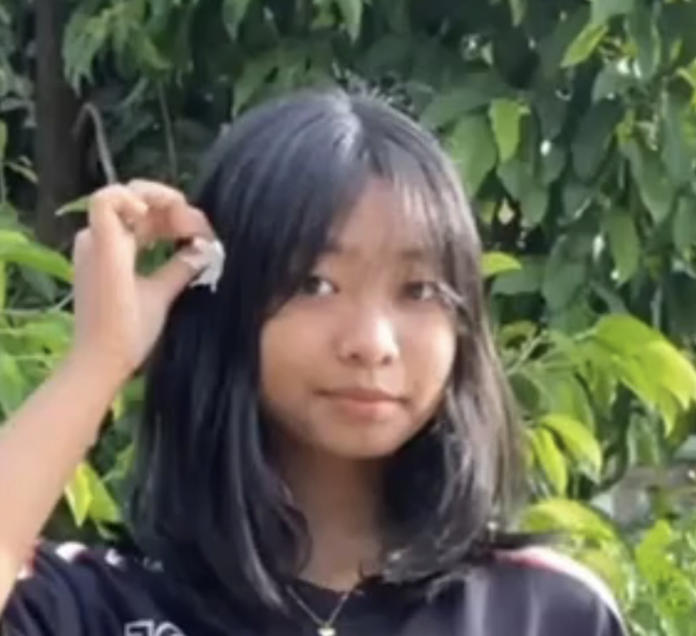

<html lang="my">
<head>
<meta charset="utf-8">
<meta name="viewport" content="width=device-width, initial-scale=1">
<title>Happy Birthday, Little Sis!</title>

</head>
<body>

  <main class="card">
    
A SPECIAL DAY FOR YOU

    <h1 class="glow">Happy Birthday! 🎂</h1>
    <h2>မွေးနေ့မှာ ပျော်ရွှင်ပါစေ ညီမလေးရေ 💗</h2>
    

      🎀
      
    

    

      လိုချင်တဲ့ဆန္ဒလေးတွေ အားလုံးပြည့်ဝပြီး 
      အမြဲပျော်ရွှင်ပြုံးရယ်နေနိုင်ပါစေ။ 🫶🏻 
      ကျန်းကျန်းမာမာနဲ့ နေ့ရက်တိုင်း လှပနေပါစေ။ 
      <strong>💖🎁</strong>
    

    <button id="wishBtn">🎉 ပျော်ရွှင်မှုလေးတွေ ဖွင့်ကြည့်မယ်</button>
    
ဒီနေ့လေးက ညီမလေးအတွက် အလှဆုံးနေ့လေး ဖြစ်ပါစေ! 🌷✨

    
Made with love ♡ for my little sister

  </main>

</body>
</html>
